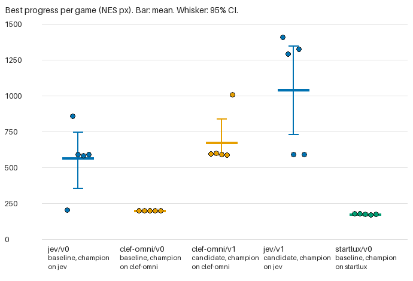
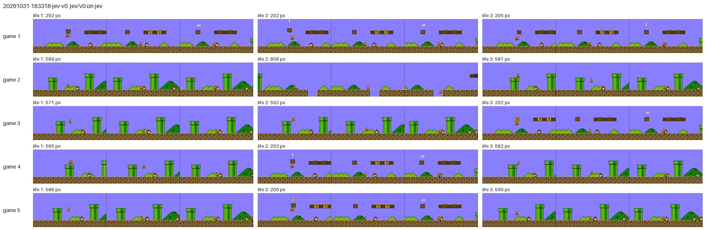
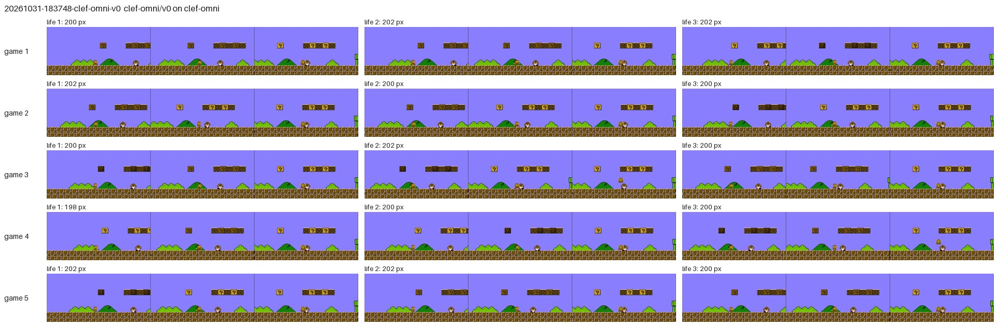
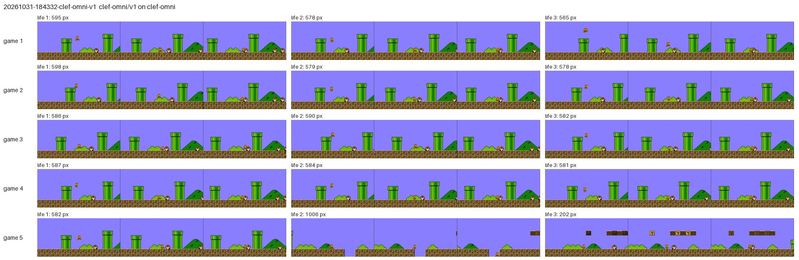
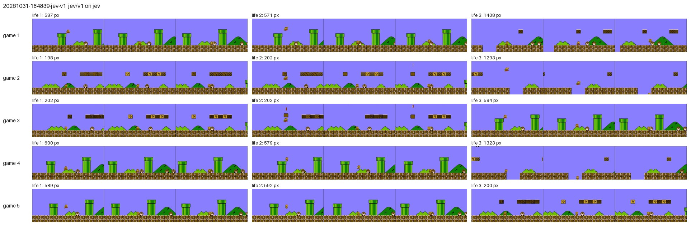
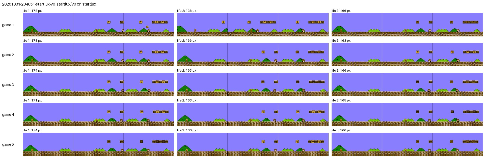

# Harness report

Generated by `python -m s1play.report` from `ledger.tsv`. Progress is the best scroll distance of any life in a game, in NES pixels. Each row is a small sample, so read the CIs before the means.

## Champions

| Model | Harness | Mean best px [95% CI] | Games | Clears | Hypothesis |
|---|---|---|---|---|---|
| clef-omni | clef-omni/v1 | 675.5 [590.1, 841.6] | 5 | 0 | Law threshold 0.1 instead of 0.5. Clef-omni's jump_now scores sit between 0.08 and 0.21 on jump frames, so a 0.1 cutoff fires the jump that 0.5 never does. |
| jev | jev/v1 | 1041.9 [732.8, 1351.0] | 5 | 0 | Law threshold 0.7 instead of 0.5. Jev separates jump frames well (AUC 0.961) but 0.5 over-jumps on 38 of 89 RUN frames, so a 0.7 cutoff trims the false jumps. |
| startlux | startlux/v0 | 175.0 [173.1, 177.0] | 5 | 0 | Baseline: the questions and law as first written. Served by StartLux-Decision-v1.1-2B-Instant-MLX-8bit. |

## Lineage

### clef-omni

| Harness | Role | Mean [95% CI] | Lower bound of delta CI | Decision | Games |
|---|---|---|---|---|---|
| clef-omni/v0 | baseline | 201.3 [200.6, 201.6] | - | champion | 201.6, 201.6, 201.6, 200.0, 201.6 |
| clef-omni/v1 | candidate | 675.5 [590.1, 841.6] | 388.8 | champion | 595.2, 598.4, 590.4, 587.2, 1006.4 |

### jev

| Harness | Role | Mean [95% CI] | Lower bound of delta CI | Decision | Games |
|---|---|---|---|---|---|
| jev/v0 | baseline | 565.4 [359.0, 749.1] | - | champion | 204.8, 857.6, 592.0, 582.4, 590.4 |
| jev/v1 | candidate | 1041.9 [732.8, 1351.0] | 97.6 | champion | 1408.0, 1292.8, 593.6, 1323.2, 592.0 |

### startlux

| Harness | Role | Mean [95% CI] | Lower bound of delta CI | Decision | Games |
|---|---|---|---|---|---|
| startlux/v0 | baseline | 175.0 [173.1, 177.0] | - | champion | 177.6, 177.6, 174.4, 171.2, 174.4 |

## Model against model

Each row is a harness. Each column is the model that played it. A cell off the diagonal is a transfer run.

| Harness | clef-omni | jev | startlux |
|---|---|---|---|
| jev/v0 |  | 565.4 [359.0, 749.1] n=5 |  |
| clef-omni/v0 | 201.3 [200.6, 201.6] n=5 |  |  |
| clef-omni/v1 | 675.5 [590.1, 841.6] n=5 |  |  |
| jev/v1 |  | 1041.9 [732.8, 1351.0] n=5 |  |
| startlux/v0 |  |  | 175.0 [173.1, 177.0] n=5 |

## What ended each life

Three frames up to the moment progress stopped, per life.

- 20261031-183318-jev-v0: 
  Progress where each life ended: 200, 202, 202, 202, 203, 205, 565, 571, 581, 582, 586, 589, 590, 592, 858
- 20261031-183748-clef-omni-v0: 
  Progress where each life ended: 198, 200, 200, 200, 200, 200, 200, 200, 200, 202, 202, 202, 202, 202, 202
- 20261031-184332-clef-omni-v1: 
  Progress where each life ended: 202, 565, 578, 578, 579, 581, 582, 582, 584, 586, 587, 590, 595, 598, 1006
- 20261031-184839-jev-v1: 
  Progress where each life ended: 198, 200, 202, 202, 202, 571, 579, 587, 589, 592, 594, 600, 1293, 1323, 1408
- 20261031-204851-startlux-v0: 
  Progress where each life ended: 138, 163, 163, 163, 165, 166, 166, 166, 166, 166, 171, 174, 174, 178, 178

## Superseded rows

Kept in the ledger but left out above, because a later row measured the same model, harness and role again: 20261031-182016-jev-v0, 20261031-182505-clef-omni-v0.
